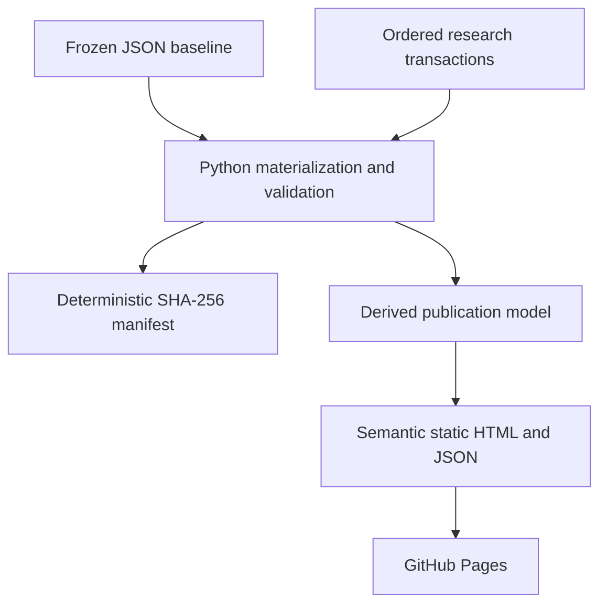

# Technology architecture

Transit Map follows [DC Public Realm](https://github.com/danielastone/dc-public-realm): GitHub is the canonical research store; Python materializes an append-only ledger; the publication is static HTML with no runtime database or API.

The existing 2026-10-16 inventory is an adoption baseline, locked by canonical JSON hashes in `data/baseline-lock.json`. No historical transactions are invented. New assertions and corrections enter through reviewed transactions; record hashes detect stale updates. Stable source IDs and hash-derived station routes do not depend on row order. Materialization validates referential integrity after every transaction and emits a deterministic semantic manifest containing baseline, transaction, intermediate, and final state hashes. Generated files are disposable and ignored by Git.

`python -m transit_map.build` writes materialized tables under `build/data/`, provenance under `build/audit/`, and publication under `build/site/`. The normal audit/validate/review-queue commands use the materialized ledger when their default sources are selected; explicit file arguments support independent research snapshots. Network fetch commands produce proposals only.

The builder joins entrance records and desktop reviews once. Station and entrance pages, unresolved review tasks, screening JSON and provenance are generated from that model. Adding data uses the existing templates, without per-station code. Pages work without JavaScript and use relative routes so both repository Pages and local hosting work. Internal links are checked during every build. There are no browser data joins, frontend framework, database server, or secrets.

Research meaning remains explicit: WMATA source records, automated proximity screens, and desktop observations are different kinds of information. Source panorama coordinates cannot support OSM edits. Tasks derive from unresolved reviews; unreviewed records still need initial review. The architecture does not assert that all 242 records are distinct physical entrances or that any new OSM feature is justified. OSM attribution accompanies publication; source licensing remains documented in `docs/DATA_SOURCES.md`.

## Delivery

Use feature branch → pull request → CI → squash merge. CI runs unit tests, validates the materialized database, builds publication and checks routes, then uploads the static artifact. GitHub Pages deployment is opt-in: configure repository Pages to use GitHub Actions and set repository variable `PAGES_ENABLED=true`. Main pushes then deploy; PRs only build. This preserves a passing research pipeline before hosting is configured.

This intentionally adopts the public-art project's architectural boundaries rather than its project-specific entity predicates, frontend parity tooling, or historical migrations. The current ledger covers research records; OSM snapshot migrations and a richer assertion/evidence graph are future schema changes, not silently implemented substitutes.
